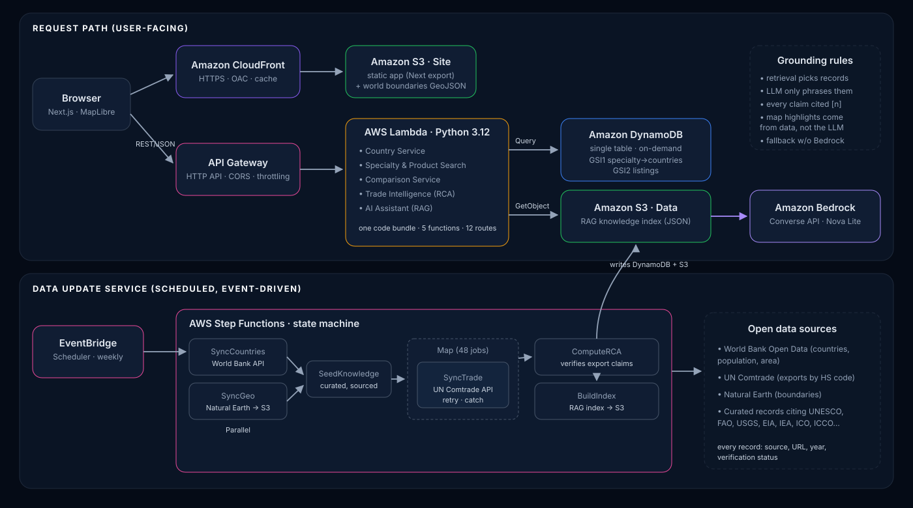

# 🌍 WorldAtlas AI

**Discover the World. Understand Its Specialties. Explore Global Intelligence.**

WorldAtlas AI turns the world map into an interactive knowledge system. Click any country to see its sourced specialties (agriculture, industry, culture, technology, resources, tourism & services). Search a product such as *olive oil* to see which countries are associated with it and who exports it. Compare countries side by side, explore export specialization with the **Revealed Comparative Advantage (RCA)** index, and ask an **AI assistant (Amazon Bedrock)** that answers only from verified, cited records.

The whole platform is **serverless**: no servers, containers or deployment pipelines to manage. When nobody uses it, it scales to zero.



---

## The problem

Information about "what a country is known for" is scattered across UNESCO lists, FAO statistics, trade databases and travel blogs. It also mixes very different claims: a dish being culturally iconic is not the same as a country dominating its exports. Students, analysts and entrepreneurs have no single place where:

1. every claim carries a **source, a reference year and a verification status**, and
2. cultural fame is kept apart from **production** and **export** evidence.

## What the build does

| Feature | How |
|---|---|
| Interactive world map (globe or flat), hover names, click to select, smooth fly-to, 8 visualization modes | MapLibre GL JS + feature-state styling, Natural Earth boundaries served from S3/CloudFront |
| Country profiles for **all ~217 World Bank economies** (+ supplementary territories) | Step Functions → World Bank API → DynamoDB |
| 6 specialty categories, typed as *cultural / production / export / characteristic* | Curated knowledge base (UNESCO, FAO, USGS, EIA, IEA, ICO, ICCO, OICA, WIPO, IFR…) with source URL, reference year and status on each record |
| Global Specialty Explorer: **Country → Specialties** and **Specialty → Countries** | DynamoDB single table + GSI1 (inverted index) |
| Country comparison (indicators with year flags, radar chart, shared/distinctive specialties, trade) | Comparison Lambda |
| Global trade intelligence: exporters, world share, **RCA**, evolution over years | UN Comtrade → Step Functions Map state → RCA Lambda |
| **Automatic claim verification**: curated export claims are confirmed (or not) by RCA | ComputeRCA writes an `rca_check` on each linked record |
| AI assistant with citations; mentioned countries highlighted on the map | Retrieval over a JSON knowledge index in S3 + Amazon Bedrock Converse (Nova Lite by default) |

**Data honesty rules.** No statistic is ever typed by hand. Numbers come only from the World Bank and UN Comtrade sync jobs. RCA is **not computed** when the inputs are incomplete (fewer than 30 reporters, or a country with no total exports). Indicators from different years are flagged as not strictly comparable. The LLM never chooses which countries to show: deterministic retrieval does.

---

## Serverless AWS services and how they connect

| Service | Role |
|---|---|
| **Amazon CloudFront + Amazon S3 (Site)** | Serves the static Next.js export and the world boundaries GeoJSON. The bucket is private and reached only through Origin Access Control. |
| **Amazon API Gateway (HTTP API)** | 12 REST routes with CORS and throttling (protects the Bedrock budget). |
| **AWS Lambda** (Python 3.12, arm64, one code bundle) | 5 API services (Country, Specialty/Search, Comparison, Trade, Assistant) + 7 pipeline tasks. Only the Python standard library and boto3: nothing to package. |
| **Amazon DynamoDB** (on-demand, single table) | Countries, specialties, country↔specialty links, raw and computed trade rows, sync metadata. GSI1 = specialty→countries, GSI2 = listings. |
| **Amazon S3 (Data)** | The RAG knowledge index (`knowledge/index.json`) built after every sync. |
| **AWS Step Functions** | The *Data Update Service*: `Parallel` (World Bank ∥ Natural Earth) → SeedKnowledge → PlanTrade → `Map` over 48 UN Comtrade jobs (retry + catch per job) → ComputeRCA → BuildIndex. One failing source never breaks the whole run. |
| **Amazon EventBridge Scheduler** | Runs the state machine weekly (`SyncSchedule` parameter). |
| **Amazon Bedrock** (Converse API) | Generates grounded answers from numbered records, citing `[n]`. If Bedrock is unavailable, the assistant falls back to returning the retrieved records. |

**Request flow.** The browser loads the app from CloudFront and calls API Gateway. Lambda reads DynamoDB (or the S3 index for the assistant). The assistant sends only the retrieved records to Bedrock and returns the answer, the sources and the ISO3 codes to highlight.

**Data flow.** EventBridge Scheduler starts Step Functions. The Lambda tasks pull the open APIs, write DynamoDB, publish the GeoJSON to the site bucket and rebuild the index in the data bucket.

Everything is defined in one **AWS SAM** template (`template.yaml`) and deployed from a laptop with `sam deploy`. There is no CI/CD pipeline to maintain.

---

## Repository layout

```
template.yaml               AWS SAM: every resource (20)
statemachine/sync.asl.json  Step Functions definition (Data Update Service)
backend/src/
  handlers/                 API Lambdas: countries, specialties, compare, trade, assistant
  pipeline/                 Step Functions tasks: sync_countries, sync_geo, seed_knowledge, trade, build_index
  common/                   db (DynamoDB/S3), rca, retrieval (RAG), sources_api (World Bank, Comtrade, Natural Earth)
  data/                     curated knowledge: categories, sources, specialties + links, trade products
backend/tests/              offline tests with in-memory DynamoDB/S3 fakes (full pipeline + every route)
frontend/                   Next.js 14 + TypeScript + Tailwind + MapLibre GL + Recharts (static export)
scripts/deploy.sh           one-command deploy (bash)   ·   scripts/deploy.ps1 (Windows)
docs/                       architecture diagram, Builder Center article, demo video script
```

---

## Deploy (about 15 minutes)

### Prerequisites
- An AWS account (the Free Tier works) and **AWS CLI v2** configured (`aws configure`)
- **AWS SAM CLI**, **Node.js 18+**, **Python 3.12**
- Region **us-east-1** recommended. Amazon Nova Lite is used by default. If Bedrock asks you to, enable access to the model once in the Bedrock console (*Model access*).

### One command
```bash
./scripts/deploy.sh          # macOS / Linux / WSL / Git Bash
# or on Windows PowerShell:
./scripts/deploy.ps1
```
The script:
1. runs `sam build && sam deploy` (creates the 20 resources);
2. starts the Step Functions sync and waits for it (about 3–6 min: World Bank, Natural Earth, 48 Comtrade queries, RCA, index);
3. builds the frontend with the API URL;
4. uploads it to S3 and invalidates CloudFront.

It prints the public URL at the end.

### Manual steps (if you prefer)
```bash
sam build && sam deploy --guided           # first time; accept CAPABILITY_IAM
aws stepfunctions start-execution --state-machine-arn <StateMachineArn output>
cd frontend && npm install
NEXT_PUBLIC_API_URL=<ApiUrl output> npm run build
aws s3 sync out s3://<SiteBucketName output> --delete --exclude "data/*"
aws cloudfront create-invalidation --distribution-id <DistributionId output> --paths "/*"
```

### Parameters (`sam deploy --parameter-overrides ...`)
| Parameter | Default | Notes |
|---|---|---|
| `BedrockModelId` | `amazon.nova-lite-v1:0` | Any Converse-compatible model or inference profile, e.g. `us.amazon.nova-lite-v1:0` |
| `TradeYears` | `2022,2023` | More years → longer trade-evolution charts |
| `ComtradeApiKey` | *(empty)* | Optional free key from comtradedeveloper.un.org (the keyless preview is capped at 500 rows per query, which is enough for world totals) |
| `SyncSchedule` | `rate(7 days)` | EventBridge Scheduler expression |

### Local development
```bash
cd frontend && cp .env.example .env.local   # set NEXT_PUBLIC_API_URL to the deployed API
npm install && npm run geo                  # downloads boundaries to public/data for local use
npm run dev                                 # http://localhost:3000
```

### Tests
```bash
python -m pytest backend/tests -q     # or: python backend/tests/test_backend.py
```
The tests run the whole Step Functions sequence with in-memory DynamoDB/S3 fakes and then call every API route. They also cover the RCA maths, the parsers, retrieval and the Bedrock fallback.

### Clean up
```bash
aws s3 rm s3://<SiteBucketName> --recursive && aws s3 rm s3://<DataBucketName> --recursive
sam delete
```

---

## API

| Method | Path | Description |
|---|---|---|
| GET | `/countries` | All countries with per-category specialty counts |
| GET | `/countries/{iso3}` | Profile, specialties by category, RCA profile, related countries |
| GET | `/categories` · `/meta` | Categories · last sync and sources |
| GET | `/specialties?q=&category=` | Product / specialty search |
| GET | `/specialties/{id}` | Countries linked to a specialty + latest trade data |
| GET | `/compare?countries=TUN,ESP` | Structured comparison (2–5 countries) |
| GET | `/trade/products` | Tracked HS products and years |
| GET | `/trade/products/{hs}?year=` | Exporters, world share, RCA |
| GET | `/trade/products/{hs}/history?countries=` | Evolution over the synced years |
| GET | `/trade/countries/{iso3}` | RCA profile of a country |
| POST | `/assistant` `{"question": "..."}` | Grounded answer, sources, countries to highlight, related questions |

## Extending
- **Add a specialty or a country link**: edit `backend/src/data/specialties.json` (one line per link, with source and year). The next sync loads it.
- **Track a new product**: add an HS code to `backend/src/data/trade_products.json`.
- **Swap the model**: change `BedrockModelId`.
- **Semantic retrieval**: the retrieval layer is isolated in `common/retrieval.py`, so you can plug in Bedrock Knowledge Bases or Titan embeddings there.

## Limitations (stated honestly)
- Curated records marked **curated** reference an organization and should be re-checked against the source edition before being quoted as rankings. **verified** records (UNESCO inscriptions) were checked for element and year.
- Trade figures are values reported by exporters to UN Comtrade. Non-reporting countries are absent, and the world totals cover reporting countries only.
- The specialty knowledge base is a representative MVP dataset. The architecture supports every country, and countries without records show an explicit empty state.

---

## 🇫🇷 Guide rapide

1. Installez AWS CLI, SAM CLI, Node 18+ et Python 3.12, puis lancez `aws configure` (région `us-east-1`).
2. Lancez `./scripts/deploy.sh` (ou `./scripts/deploy.ps1` sous Windows) et attendez l'URL finale.
3. Si l'assistant indique « Retrieved records (model unavailable) », activez le modèle *Amazon Nova Lite* dans la console Bedrock (*Model access*).
4. Pour la vidéo : suivez `docs/demo-video-script.md` (moins de 3 minutes).
5. Pour l'article Builder Center : copiez `docs/builder-center-article.md` et ajoutez `docs/architecture.png`.
