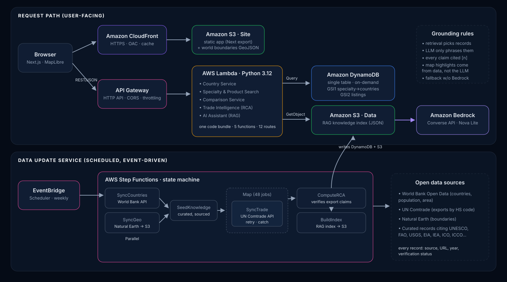

# WorldAtlas AI: a serverless atlas that knows *why* a country is famous, and proves it

*Weekend Challenge: No Pipeline, No Problem*

> Demo video: **[link to your < 3 min video]** · Code: **[link to your public repo]**

## The problem

Ask "what is Tunisia famous for?" and the web gives you a mix of travel blogs, Wikipedia lists and trade statistics. The answers rarely tell you where a claim comes from or what kind of claim it is. A dish can be culturally iconic without the country exporting much of it. A country can dominate the exports of a product nobody associates with it.

Students, analysts and entrepreneurs need an atlas where every specialty is **sourced, dated and typed**, and where economic claims are **checked against real trade data**.

## What I built

**WorldAtlas AI** is an interactive world map (globe or flat) connected to a knowledge base of country specialties in six categories: Agriculture & Food, Industry, Culture & Heritage, Technology, Natural Resources & Energy, and Tourism & Services.

- **Explore**: click any of the ~217 countries to get a profile (World Bank data with reference years) and specialty cards. Each card shows its type (*cultural, production, export, characteristic*), source organization, URL, reference year and verification status.
- **Search both ways**: *Country → Specialties* and *Specialty → Countries*. Search "olive oil" and the map lights up the associated countries, with exporters and world shares from UN Comtrade.
- **Compare** 2–5 countries: indicators (flagged when reporting years differ), a radar chart of recorded specialties, shared and distinctive specialties, and an export comparison.
- **Global Trade**: for 23 tracked HS products, exporters, world share and the **Revealed Comparative Advantage** index. The map is colored by RCA, and the trend covers several years.
- **Self-verifying knowledge**: after each sync, every curated *export* claim is checked against the computed RCA. The card then shows the computed RCA, the UN Comtrade year, and whether the export specialization is confirmed or not.
- **AI Assistant**: natural-language questions, answered by **Amazon Bedrock** *only* from retrieved records, with numbered citations. The countries in the answer are highlighted on the map, and related questions are suggested.

## Architecture: every piece is serverless

**Request path**
1. **Amazon CloudFront** serves the static Next.js app from a private **Amazon S3** bucket through Origin Access Control. The same bucket hosts the simplified world boundaries GeoJSON.
2. The browser calls an **Amazon API Gateway HTTP API** (12 routes, CORS, throttling).
3. Five **AWS Lambda** functions (Python 3.12 on Graviton, one shared code bundle, no dependencies to package) implement the Country, Specialty Search, Comparison, Trade Intelligence and AI Assistant services.
4. They read a single **Amazon DynamoDB** table (on-demand). `GSI1` inverts country→specialty into specialty→countries, and `GSI2` serves listings.
5. The Assistant Lambda loads a JSON knowledge index from a second S3 bucket, retrieves numbered records deterministically, and calls **Amazon Bedrock** (Converse API, Amazon Nova Lite) with strict grounding rules. The LLM only phrases the answer. The map highlights come from the retrieval step, never from the model. If Bedrock is unavailable, the API still answers with the retrieved records.

**Data Update Service**
- **Amazon EventBridge Scheduler** starts an **AWS Step Functions** state machine every week:
  - `Parallel`: World Bank country registry, population and area ∥ Natural Earth boundaries → S3
  - `SeedKnowledge`: validates and loads the curated, sourced knowledge base
  - `Map` (48 jobs, `MaxConcurrency: 1`, retry + catch per job): UN Comtrade exports per product and year
  - `ComputeRCA`: computes RCA(c,p) = (Xc,p/Xc) ÷ (Xw,p/Xw) over a *consistent* set of reporters, refuses to compute from incomplete data, and stamps the verification result on each claim
  - `BuildIndex`: rebuilds the RAG index in S3 and records the sync status

A failing source never breaks the run: each branch catches its error and the rest of the data stays fresh.

**Why this design scales to zero.** There are no servers, no containers and no provisioned capacity. DynamoDB is on-demand, Lambda and API Gateway are pay-per-request, and Bedrock is pay-per-token. CloudFront caches the app, and API responses carry `Cache-Control`. When nobody uses the app, almost nothing runs except a weekly workflow of a few minutes.

## How I set it up (reusable pattern)

Everything is in **one AWS SAM template**: 20 resources, including the Step Functions definition with `DefinitionSubstitutions` and an EventBridge Scheduler event (`ScheduleV2`) attached to the state machine. Deployment is one script on a laptop: `sam build && sam deploy`, then start the state machine once, then `npm run build` and `aws s3 sync`. There is no pipeline to maintain.

Patterns worth reusing:
- **Step Functions `Map` + per-item `Catch`** to pull a rate-limited public API politely and resiliently.
- **Pipeline-time verification**: let your data pipeline check the claims your app makes, and show the result to the user.
- **RAG with deterministic retrieval**: the model writes the answer, the data decides what is shown.
- **Single-table DynamoDB with an inverted GSI** for many-to-many exploration (country ↔ specialty).

## Data honesty

- No statistic is typed by hand. Numbers come only from the World Bank and UN Comtrade sync jobs.
- Every specialty record has a source organization, URL, reference year and status (*verified* or *curated*). UNESCO inscriptions are verified for element and year.
- Cultural fame is never presented as economic dominance, and the four specialty types are always labelled.
- RCA is not computed when inputs are incomplete. Indicators from different years are flagged as not strictly comparable.

## What's next

Bedrock Knowledge Bases for semantic retrieval, FAOSTAT production volumes, more HS products and years, and user-contributed specialties going through a review workflow (Step Functions human approval).

**Built with:** AWS Lambda · Amazon API Gateway · Amazon DynamoDB · Amazon S3 · Amazon CloudFront · AWS Step Functions · Amazon EventBridge Scheduler · Amazon Bedrock · AWS SAM · Next.js · MapLibre GL JS · Recharts
